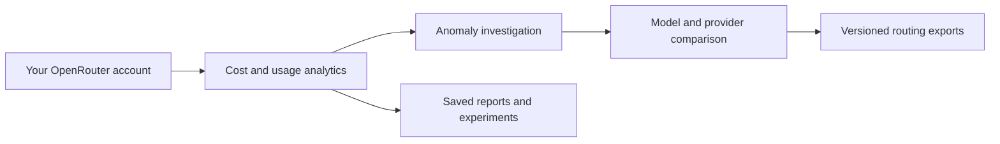

# OpenRouter Workbench — Cost Analytics, Usage Tracking & MCP Tools

[](https://github.com/cyuanxv/openrouter-analytics-mcp/actions/workflows/ci.yml)

> 0.6.0-alpha.3 is the local alpha version. See the current channel status in [publication and verification](docs/PUBLISHING-STATUS.md).


[简体中文](README.md) | English

**Understand your AI spend. Make your next model decision with confidence.**

A self-hosted **OpenRouter cost analytics and LLM usage dashboard** for personal use. Explore spending by model and provider, investigate cost anomalies, save weekly reports, compare models, and export versioned routing presets — with MCP tools for local desktop clients or, through your own Sites deployment, ChatGPT.

Move from billing totals to evidence, from model comparisons to reusable plans. Incomplete data stays clearly marked, so missing evidence never becomes false certainty.

**Built by cyuanxv · [Follow @cyuanxv on X / Twitter](https://x.com/cyuanxv)**
Independent third-party project. Not an official OpenRouter product or endorsed by OpenRouter.


## Interface preview


Actual Sites web interface rendered from the current source with synthetic local data. Amounts are not real bills or model prices.

The local edition includes [Chinese installation diagnostics](docs/DOCTOR.md), with offline and JSON modes.

## From spending questions to model decisions



*Conceptual feature flow, not a product screenshot. You integrate exported configurations into your application; this service does not switch production models.*

## Getting started

Follow the [Chinese quickstart](docs/QUICKSTART.md) to configure your own Key, run diagnostics, query your account, and save and read your first cost report. See the [Chinese FAQ](docs/FAQ.md) for common setup issues. These guides cover the local MCP edition; Sites deployment is separate.

## Example questions in your MCP client

- “What did I spend on OpenRouter yesterday, and which models drove it?”
- “Investigate my recent cost anomalies and show the data coverage.”
- “Save last week's cost report without sending a notification.”
- “Compare these models and help me save a fallback configuration.”

## Choose your edition

Both editions share 28 MCP tools; their hosting and companion features differ.

| | Local MCP · 0.6.0-alpha.3 | Sites cloud · 0.5.0 |
| --- | --- | --- |
| Runs on | Your computer; the process must stay running | Your own ChatGPT Sites project; your computer can be off |
| Access | A local stdio MCP client, such as Cursor | Your private web dashboard and ChatGPT cloud plugin |
| Storage | SQLite in a dedicated local directory | Your own Sites D1 database |
| Requirements | Node.js 22.22+ (22.x) or 24+, an MCP client; your own Management Key for account queries | Sites access, trusted identity, D1 and server-side secrets; your own Management Key for account queries |
| Web dashboard | Not included; the preview above shows the Sites edition | Included |
| Scheduled reports and Telegram | No built-in scheduler or automatic sending | Requires separately configured cloud tasks and a Telegram notification channel |
| Installation | [Local MCP guide](packages/local-mcp/README.md#english) | [Sites deployment guide (Chinese)](docs/INSTALL.md) |

**ChatGPT cloud cannot directly launch a local stdio process.** Choose the local edition for a desktop MCP client, or Sites for a private web dashboard and ChatGPT cloud access. The author's private service is not a public installation endpoint.

Neither edition is a shared public billing service. Install the local edition with `npm install --ignore-scripts @cyuanxv/openrouter-analytics-mcp@0.6.0-alpha.3`. See the local guide for client configuration, or download the [GitHub Release](https://github.com/cyuanxv/openrouter-analytics-mcp/releases/tag/v0.6.0-alpha.3) tarball.

Local 0.6.0-alpha.3 adds [readable cost reports](docs/REPORT-READING.md): spending and period changes first, followed by model contributions and explicit data gaps. Existing reports stay unchanged.

## Features

- Check account credit, spending, and usage by model or provider.
- Inspect call metadata without reading prompts or response bodies.
- Detect and investigate spending anomalies, with explicit data-completeness limits.
- Generate and store weekly reports and daily alert records.
- Compare models and record cost experiments.
- Save, preview, and export personal model and routing presets.

Reports, experiments, and presets are stored in your own database. Account queries do not modify your OpenRouter account. The service does not run paid inference, top up credit, modify API keys, or automatically switch production model routing. Scheduled Telegram delivery requires separately configured cloud tasks and notification access; generating a report does not send it.

## Sites deployment requirements

For the **Sites cloud edition**, you need:

- Your own OpenRouter account and Management Key.
- ChatGPT Sites access with private hosting, trusted identity forwarding, D1 storage, and server-side secrets.
- Git, npm, and Node.js for local validation. The installation guide specifies Node.js 22 LTS; the recorded acceptance run used Node.js 23.6.1 and npm 10.9.2.

The author does not provide a shared public billing service. You manage your own deployment, credentials, and account or hosting costs. Keep your Management Key in your Site's server-side secret settings; never send it to the author or put it in chat, Git, browser code, or plugin manifests.

## Validate source without credentials

For the local MCP edition, from the full source tree:

```bash
cd openrouter-analytics-mcp/packages/local-mcp
npm ci --ignore-scripts
npm run build
npm test
```

The build reuses `services/routerlens`; copying only the package subfolder is insufficient. The installable tarball already contains built files and needs no source build. See the [local installation guide](packages/local-mcp/README.md#english).

For the Sites service source:

```bash
cd openrouter-analytics-mcp/services/routerlens
npm ci --ignore-scripts
npm run build
npm test
npm run validate
```

These commands build the service and run tests with simulated data. They do not deploy a Site or access a real OpenRouter account.

## Deploy your own private Site

See the complete [installation guide (Chinese)](docs/INSTALL.md). The required steps are:

1. Create a new owner-private Sites project and use its project ID and final HTTPS origin.
2. Set `OWNER_EMAIL` and `SITE_ORIGIN` in `worker/index.ts`. Update the email in `ownerHeaders` and the `base` URL in `tests/worker.test.mjs` to match. Set your project ID in `.openai/hosting.json`.
3. Preserve the owner checks and trusted Sites identity boundary. Do not trust identity headers supplied directly by a public client.
4. Keep the `DB` D1 binding and `mcp` capability in the hosting manifest. The build includes the migrations in `dist/.openai/drizzle`; Sites applies them when publishing.
5. Configure `OPENROUTER_MANAGEMENT_KEY` as a server-side secret in the new Site.
6. Rebuild, run the tests and artifact validation, then publish through the supported Sites workflow. Redeploy a saved version after changing secrets so the new configuration takes effect.
7. Use the private plugin that Sites creates for your deployment. Install or connect it if needed. Call `routerlens_status` to verify identity, then an account tool to verify actual OpenRouter connectivity.

The root plugin manifests are configuration templates. Their `routerlens.example.invalid` endpoint is intentionally unusable: replace it only in your own configured copy with your verified deployment endpoint. The official OpenRouter MCP service is separate and has its own authorization and tool permissions.

This is not a generic Vercel or arbitrary Worker deployment package, and it does not support public multi-user registration or team data isolation.

## Verification and limitations

A previous Sites self-hosting acceptance deployed an independent private project and fresh database from the self-hosting source. This is historical cloud evidence, not a deployment of this local release. The acceptance run passed 192 tests, build and artifact validation, native MCP authentication, real account queries, browser queries, and report/preset save-and-readback checks.

This was a new project under the same owner account, not a test with another person's ChatGPT account. External Telegram delivery and every parameter combination were not tested. Missing or truncated analytics data remains explicitly incomplete; a successful report does not guarantee historical anomaly attribution.

See the [acceptance record (Chinese)](docs/SELFHOST-VALIDATION.md), [feature boundaries (Chinese)](docs/FEATURES.md), and [security guidance](SECURITY.md).

## License and project status

Code is licensed under [Apache-2.0](LICENSE). OpenRouter branding is not granted under this project's code license; see [asset attribution](assets/README.md).


## Source and packages

Clone or extract the source into `openrouter-analytics-mcp` before running the commands above. This repository starts from a clean source snapshot and does not include the original private repository history or deployment configuration.

[GitHub description, topics and social preview setup (Chinese)](docs/GITHUB-SETUP.md)

[MCP Registry requirements and draft (Chinese; local edition)](docs/registry/ASSESSMENT.md)

[Local installable MCP edition (0.6.0-alpha.3, all 28 tools)](packages/local-mcp/README.md)

[Local package installation and validation (Chinese)](docs/LOCAL-VALIDATION.md)

[Local package read-only account acceptance (Chinese)](docs/LOCAL-ACCOUNT-VALIDATION.md)

[Release preparation / 发布前清单](docs/RELEASE-CANDIDATE.md) · [0.6.0-alpha.3 notes](docs/RELEASE-NOTES-0.6.0-alpha.3.md)

[Cursor desktop installation acceptance / 桌面安装验收](docs/DESKTOP-VALIDATION.md)

## Copyright and license

**© 2026 cyuanxv · [X / Twitter @cyuanxv](https://x.com/cyuanxv)**

Licensed under [Apache-2.0](LICENSE). Rights to the OpenRouter name and official icon remain with their respective owners.


[Automated testing](docs/TESTING.md): Linux Node 22/24 source builds, synthetic tests and packed-install stdio checks. See CI for actual run results.
