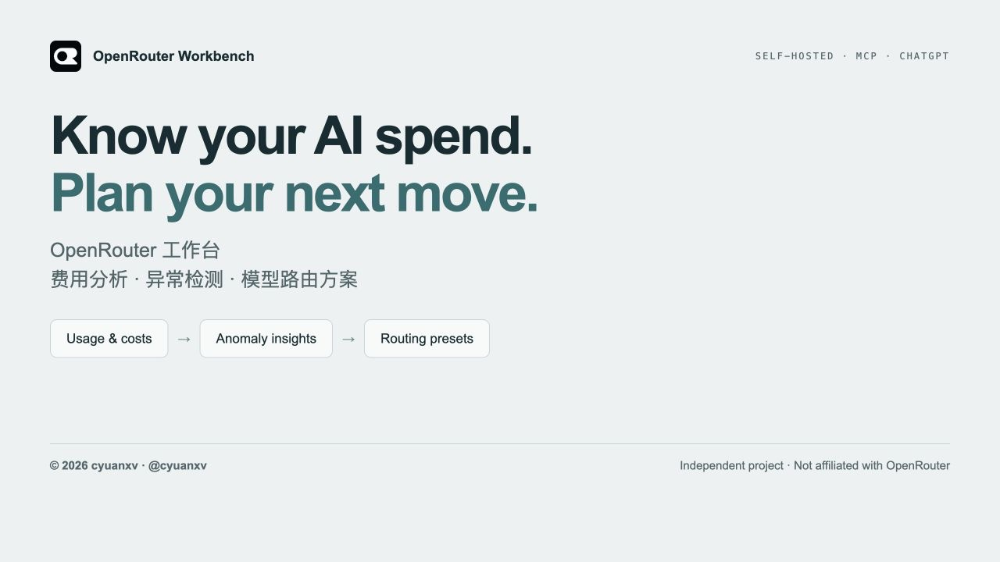
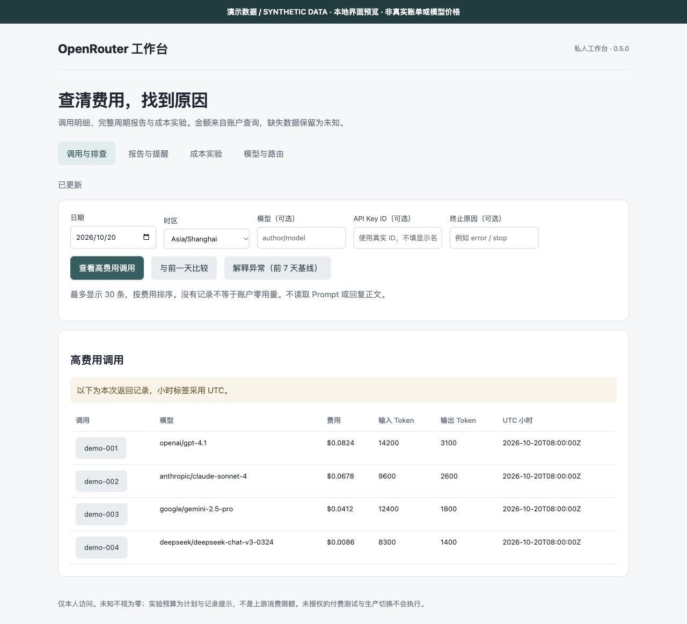
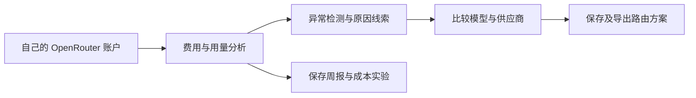

# OpenRouter 工作台｜费用分析、异常检测与模型路由配置

[](https://github.com/cyuanxv/openrouter-analytics-mcp/actions/workflows/ci.yml)

> 0.6.0-alpha.3 为本地版 alpha 版本；各渠道发布与验收状态见[发布与验收记录](docs/PUBLISHING-STATUS.md)。



简体中文 | [English](README.en.md)

**看懂每一笔 AI 开销，让下一次模型选择更有把握。**

OpenRouter 工作台（OpenRouter Workbench）是一个可自行部署的 **OpenRouter 费用分析与 LLM 用量管理工具**。把余额查询、模型与供应商费用拆解、异常检测、周报和模型路由方案集中到一个个人工作台，通过 MCP 在本地客户端中使用；部署 Sites 云端版后，也能在 ChatGPT 中查询。

不止看到账单数字：找到费用变化的线索，比较模型选择，保存可追溯的方案，把分析变成下一步行动。

**由 cyuanxv 开发 · [在 X / Twitter 关注 @cyuanxv](https://x.com/cyuanxv)**
第三方项目，非 OpenRouter 官方产品，未获官方背书。


## 界面预览



Sites 版当前源码真实界面，使用本地模拟数据；金额不是实际账单或模型报价。

## 从费用问题，到模型决策



*功能流程示意，非界面截图；导出的方案需由你接入业务，工作台不会自动切换线上模型。*

## 为什么用它？

- **知道钱花在哪里**：按模型、供应商和时间查看用量与费用，不再只盯着总金额。
- **让异常开销有迹可循**：检测费用变化并提供归因线索；数据不足会明确标注，不把未知当正常。
- **把一次分析变成持续记录**：保存周报、异常记录和成本实验，方便回看与比较。
- **把模型选择变成可复用方案**：保存主模型、备用模型与供应商偏好，管理版本并导出请求配置。
- **让自己的数据留在自己的部署中**：本地版保存到自己的 SQLite，Sites 版保存到自己的云端数据库；账户查询会访问 OpenRouter，工具返回结果受所用客户端的数据政策约束。

## 第一次使用

从 [新用户快速上手](docs/QUICKSTART.md) 开始：配置 Key → 运行中文自检 → 查询账户 → 保存并查看第一份费用报告。遇到问题查看 [常见问题](docs/FAQ.md)。教程以本地 MCP 版为主，Sites 部署请按下方对应说明。

## 可以直接问的问题

- “昨天 OpenRouter 花了多少钱？主要花在哪些模型上？”
- “最近七天有没有费用异常？数据够不够支持这个结论？”
- “生成上一周的费用报告并保存，不发送通知。”
- “比较这几个模型，并帮我保存一个包含备用模型的方案。”

## 选择本地版还是 Sites 云端版

两种版本共享 28 个 MCP 工具，但运行方式与配套能力不同：

| 对比 | 本地 MCP 版 · 0.6.0-alpha.3 | Sites 云端版 · 0.5.0 |
| --- | --- | --- |
| 运行位置 | 自己的电脑，需保持进程运行 | 自己的 ChatGPT Sites 项目，不依赖本机持续开机 |
| 使用入口 | 支持本地 stdio 的 MCP 客户端，例如 Cursor | 自己的私有网页和 ChatGPT 云端插件 |
| 数据保存 | 本机专用目录中的 SQLite | 自己的 Sites D1 数据库 |
| 必要条件 | Node.js 22.22+（22 系列）或 24+、MCP 客户端；账户查询需自己的 Management Key | Sites 相应权限、身份认证、D1 和服务端秘密配置；账户查询需自己的 Management Key |
| 网页界面 | 不附带；上方截图展示的是 Sites 网页 | 提供网页工作台 |
| 定时报告和 Telegram | 无内置调度或自动发送 | 需另行配置云端任务与 Telegram 通知通道，不随源码自动启用 |
| 安装说明 | [本地版安装](packages/local-mcp/README.md) | [Sites 云端部署](docs/INSTALL.md) |

**本地 stdio 进程不能直接作为 ChatGPT 云端连接入口。** 想在电脑上的 MCP 客户端使用，选本地版；想用网页或 ChatGPT 云端连接，选 Sites 版。现有作者私人服务不供公共安装使用。

本地版安装：`npm install --ignore-scripts @cyuanxv/openrouter-analytics-mcp@0.6.0-alpha.3`。客户端配置见[本地安装说明](packages/local-mcp/README.md)，也可使用 [GitHub Release](https://github.com/cyuanxv/openrouter-analytics-mcp/releases/tag/v0.6.0-alpha.3) 安装包。另见[功能与边界](docs/FEATURES.md)和[安全说明](SECURITY.md)。

本地版新增 [安装与配置自检](docs/DOCTOR.md)，提供中文诊断、离线与 JSON 模式。

## 可以做什么

查余额和费用、分析模型与供应商用量、查询调用元信息、检测及解释费用异常、保存周报与提醒记录、比较模型、记录成本实验、保存和导出模型路由方案。

报告与预设会写入部署者自己的数据库；上游账户查询不修改 OpenRouter 账户。不会执行付费模型推理、充值、修改 Key 或自动替业务切换模型。Telegram 定时发送由另行配置的云端任务完成。

## 验证源码（不需要密钥）

验证本地 MCP 版：

```bash
cd openrouter-analytics-mcp/packages/local-mcp
npm ci --ignore-scripts
npm run build
npm test
```

需使用完整源码树，构建会复用 `services/routerlens`。仅安装发行包无需构建，见[本地版安装说明](packages/local-mcp/README.md)。

验证 Sites 服务源码：

```bash
cd openrouter-analytics-mcp/services/routerlens
npm ci --ignore-scripts
npm run build
npm test
npm run validate
```

此流程验证构建和模拟测试，不创建云服务、不调用真实账户。部署请先完整阅读[安装说明](docs/INSTALL.md)。

## 发布方式：下载源码，自行部署

已确定采用个人自行部署方式。cyuanxv 提供开源代码和文档，不提供面向公众的托管账单服务；使用者负责自己的部署、OpenRouter 账户、密钥及托管费用。当前不提交 ChatGPT 审核。

## 开源许可与历史材料

代码采用 Apache-2.0，参见 [LICENSE](LICENSE)。品牌图标属于 OpenRouter，不纳入本项目代码许可证的授权范围，见 [素材说明](assets/README.md)。

**提供自部署源码和本地 MCP 安装包，暂不上架 ChatGPT。** 根目录插件清单是需要使用者配置的模板，分析服务地址为无效占位符，不能原样连接。


## 源码与安装包

下载源码或克隆仓库到 `openrouter-analytics-mcp` 目录。本仓库以干净源码建立独立历史，不包含原私人仓库历史或私人部署配置。


[GitHub 简介、Topics 与分享封面配置草稿](docs/GITHUB-SETUP.md)

[MCP Registry 发布条件与登记材料](docs/registry/ASSESSMENT.md)

[本地可安装 MCP 版（0.6.0-alpha.3，完整 28 工具）](packages/local-mcp/README.md)

[本地包安装与验收结果](docs/LOCAL-VALIDATION.md)

[本地包真实账户只读验收](docs/LOCAL-ACCOUNT-VALIDATION.md)

[Release preparation / 发布前清单](docs/RELEASE-CANDIDATE.md) · [0.6.0-alpha.3 notes](docs/RELEASE-NOTES-0.6.0-alpha.3.md)

[Cursor desktop installation acceptance / 桌面安装验收](docs/DESKTOP-VALIDATION.md)

## 版权与许可

**© 2026 cyuanxv · [X / Twitter @cyuanxv](https://x.com/cyuanxv)**

本项目采用 [Apache-2.0 许可证](LICENSE)。OpenRouter 名称及官方图标的权利归其各自权利人所有。


[自动测试与验收范围](docs/TESTING.md)：Linux Node 22/24 构建、模拟测试及安装包 stdio 检查；当前运行结果见 CI。
